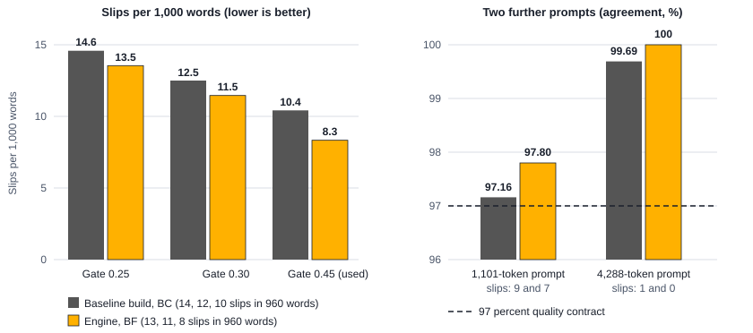
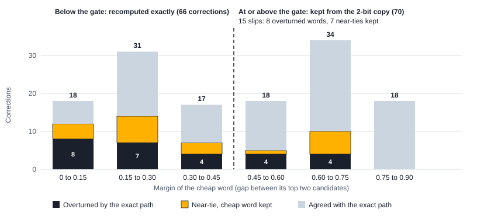
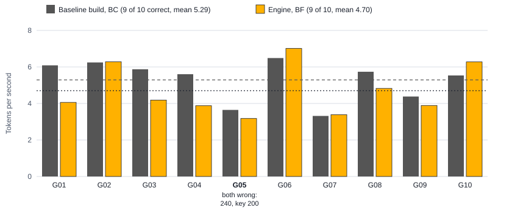
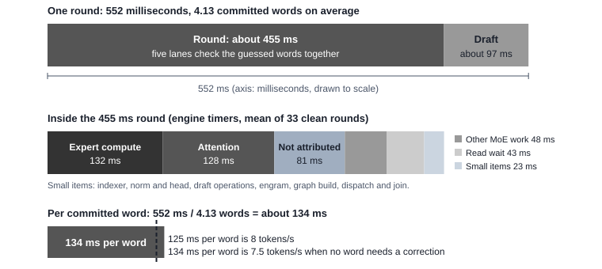
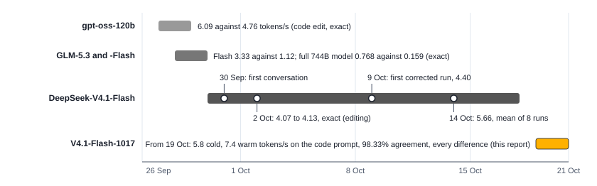
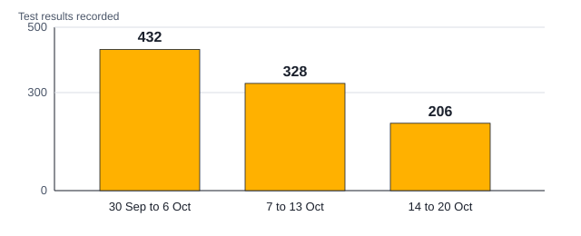

# Compress-then-Correct Decoding: The Full DeepSeek-V4.1-Flash-1017 on a Five-Year-Old Gaming PC

Ryan Flavell

MAGNVS Ltd, United Kingdom · ryan@magnvs.co.uk

PROMETHEVS Technical Report 1 · version 0.1 (research preview) · October 2026

## Abstract

PROMETHEVS runs the full DeepSeek-V4.1-Flash-1017, a 510 GB mixture-of-experts model, on a five-year-old gaming PC (Ryzen 9 3950X, 64 GB of DDR4, an RTX 3060 with 12 GB, two NVMe drives). The method is compress, then correct. Every word is first computed on a 2-bit copy of the model's experts, which reads about 60 percent of the bytes of the original. The model's own confidence, the margin between its top two candidates, then marks the words it may have got wrong, and only those are recomputed with the original FP4 weights, which a stored correction plane rebuilds from the 2-bit copy. The engine runs at nearly the speed of the 2-bit copy while staying close to the original model. On a code prompt it generates 5.8 tokens per second from a cold cache and 7.4 once the cache is warm, against 2.14 for plain exact decoding on the same machine; with the corrections switched off, the 2-bit copy ran the same warm pass at 7.7 (one pass, in a separate test build). Reasoning and agent prompts run at 4.4 to 5.2. On 960 audited words, the 2-bit copy alone picks the same word as the original weights 97.40 percent of the time, and the corrected output 98.33 percent. The differences left are near-ties the engine keeps on purpose, where the two candidates are almost equally likely, and words the model was confident about and never checked; counting only those unchecked words, agreement is 99.17 percent. These percentages count the differences an audit at gate 0.9 detected; words with a margin of 0.9 or more were not checked, and on the longer 1,101-token agent prompt agreement counting every difference is 95.91 percent. This report describes the mechanism, measures where each word's time goes, accounts for what each component contributed, records the forms we tested that did not help, and gives the dated development history from gpt-oss-120b to these weights. We have not yet compared the output with DeepSeek's reference implementation, and the 8 tokens per second milestone we set is not reached on any prompt. This release contains the report and the logs; the engine program will follow in a later release.

**Keywords:** mixture of experts; local inference; speculative decoding; quantisation; consumer hardware

## 1 Introduction

Frontier-class open models are released as mixture-of-experts networks with hundreds of gigabytes of weights. DeepSeek-V4.1-Flash-1017 is 510 GB; a well-equipped desktop has 64 GB of RAM and a graphics card with 12 GB. Running such a model locally usually means a multi-GPU server, a cloud subscription, or a smaller model in its place. We ask whether one ordinary desktop can run the full model, give the full model's answer on nearly every word, and do so at a usable speed.

**Why we did this.** Frontier-level AI today needs either a cloud subscription or hardware costing tens of thousands of pounds. PROMETHEVS, named after Prometheus, who in the myth brought fire to people, sets out to change that: the capability of a frontier model, at a speed close to the cloud, within 97 percent of what the original full weights would say, on a computer people already own. This report is the first step: one frontier-class open model on one five-year-old gaming PC.

Our engine, PROMETHEVS, does the cheap thing first and the exact thing only where it matters. It computes every word on a 2-bit copy of the experts, which needs fewer bytes from disk than the original; it uses the model's own confidence to decide which words to distrust; and it recomputes only those words with the exact weights. A draft head supplied with the model proposes several words at a time, so the cost of reading experts is shared across them. The exact path therefore runs only where the model itself is unsure. The result is not a plain quantised model but a 2-bit stream corrected toward the original weights. Wherever the model doubts a word, the original weights decide it, except at near-ties, which the engine keeps on purpose. Every difference that remains is counted, and every speed figure in this report carries its measured agreement with the exact path.

This report makes five contributions:

- A method, compress-then-correct: every word is computed on a 2-bit copy, the words the model itself doubts are flagged, and those words are recomputed with the exact experts, which a stored correction plane can rebuild from the 2-bit copy. We describe each part of the mechanism (Section 3).
- A working engine that runs DeepSeek-V4.1-Flash-1017 on a desktop with 64 GB of DDR4, an RTX 3060 (12 GB) and two NVMe drives, at 5.8 tokens per second from a cold cache and 7.4 warm on a code prompt, about 2.7 times plain exact decoding at a cold start, and 4.4 to 5.2 on reasoning and agent prompts (Section 5).
- A word-level audit of the output against the engine's exact path, with every disagreement counted: 98.33 percent agreement over 960 words counting every difference (99.17 percent by the unchecked count), and an analysis of which words the confidence gate does and does not catch (Sections 5.3 and 5.4).
- A measured account of where the time goes, of what each component contributed, and of the forms we tested that did not help (Sections 6 to 8).
- A dated record of how the engine was developed across four models, from gpt-oss-120b to the 1017 weights (Section 9).

Section 2 states what we claim and what we do not, Section 3 describes the method, Section 4 the machine, model and protocol, Section 5 the results, Section 6 the time budget, Section 7 the contribution of each component, Section 8 the negative results, Section 9 the development history, Section 10 sets the method beside the work it builds on, and Section 11 gives the limitations.

## 2 What we claim and what we do not

We keep four claims apart, because they are easily confused.

**Weight identity.** Exact means the format DeepSeek released. In DeepSeek-V4.1-Flash-1017 the routed experts are FP4 (packed in int8 with FP8 scales), and the attention, shared-expert and embedding matrices are FP8, with norms, gates and a few small tensors in BF16 or FP32 (read from the checkpoint's safetensors headers). The engine runs the non-expert weights as released, and it rebuilds each FP4 expert exactly from its 2-bit copy and its correction plane.

**Engine exactness.** The engine's reference path is bit-identical to one-word decoding of the same files. It uses batch-invariant kernels, which give the same answer whether one guessed word or several are checked together, on the CPU or the GPU, and a fixed order of reduction. Building these exposed batch-dependent arithmetic in the stock engine we started from.

**Agreement with the full model.** On the corrected route, committed words are compared with the exact path, and the result is a measured fraction of words that differ, not a promise of identity. Until 14 October every accepted change had to leave the output identical; on that day we replaced "exact" with a measured quality contract of at least 97 percent agreement, so that speed work could go on while every change carried its measured cost in quality, and every speed claim must carry its slip rate. Exact decoding remains the reference the audits compare against.

**Task capability.** Whether the final answers on tasks match is a fourth and separate question. We report ten GSM8K problems (Section 5.5) and make no claim of general capability: parameter count and agreement with the exact path do not establish it.

## 3 The method: compress, then correct

The PROMETHEVS engine produces each word in four steps (Figure 1). A round is one engine step that checks several guessed words together; a pass is one 160-token generation. We call this compress-then-correct decoding; in the project's records it is the Promethean Method.

*Figure 1: Compress-then-correct decoding: how the engine produces a word. The draft head's guesses are checked together in five parallel lanes on the 2-bit copy of the experts. Words whose margin between the top two candidates falls below the gate are redone with the exact expert before they are committed.*

### 3.1 The cheap pass

Each expert is stored in two layers. The first is a 2-bit copy, about 11.5 MB against about 18.8 MB for the FP4 original, 0.61 of the bytes; the engine computes every word on it, so each word needs fewer bytes from disk. The experts are the bulk of the model. The model picks 6 routed experts in each of its 40 layers, 240 picks for each new word: 240 x 18.8 MB is 4.5 GB in FP4 and 240 x 11.5 MB is 2.8 GB in the 2-bit copy, before caching and expert skip (arithmetic on the sizes above).

### 3.2 Flagging words: the margin gate

Decoding is greedy (no sampling). For each word the engine measures the margin, the gap between the logits of the model's top two candidates on the cheap pass. When the margin falls below a threshold, the gate (0.45 in our runs), the word is flagged as one the cheap pass may have got wrong. The gate is a trade between quality and time: a lower gate corrects fewer words and leaves more mistakes in (Table 6); a higher gate recomputes more words that the exact path agrees with (Section 5.4).

When the exact path's word differs from the cheap word but the two are almost tied on the exact path (the cheap word is the exact path's runner-up, less than 0.5 logits behind, and contains no digit or operator), the engine may keep the cheap word (near-tie acceptance, 0.5 in our runs). This avoids paying for an overturn on a pair of words the model rates almost equally. A small gap is a low-confidence signal, not proof that both words are equally good. A near-tie difference above the gate is never checked and counts as a slip; one below it was checked and kept, and counts only in the every-difference figure (Section 4.4).

### 3.3 Correcting: the exact expert from the 2-bit copy and a plane

The second layer is the correction plane. Added to the 2-bit copy, it rebuilds the exact FP4 expert, so a correction returns the full weights' answer for that word, given the attention history so far. The history rows of earlier words stay as the cheap pass made them, except after an overturn (below). The correction runs on the GPU. In the engine's runs a correction rebuilds 190 to 231 experts from their 2-bit copy and plane and reads 9 to 50 directly from the FP4 originals, which the engine also keeps; 89 percent of the experts a correction uses come from the plane. The engine reads the FP4 original instead of rebuilding when the 2-bit copy is not resident in memory, when no plane exists for the expert, when the pairing check between copy and plane refuses the record, or when the plane read fails; the log counts each case, and in the engine's runs every fallback was a copy not resident. "2-bit" names the width of the codes; the 11.5 MB we quote for a stored expert, against 18.8 MB for the FP4 expert (0.61), is the size as stored.

When the exact answer differs from the cheap one, the correction overturns the word. The guesses after it in the same round are discarded, and the last two rows of attention history are recomputed exactly before decoding continues, to limit the cheap word's influence on the next step; earlier history rows keep the values the cheap pass gave them. An overturned word costs 2.6 to 3.2 s on the code prompt of these weights. These costs, and the rate of overturns, are why the gate matters.

### 3.4 The draft head and the lanes

DeepSeek ships a draft head with the model. It proposes a block of five words, the anchor (the word the model has already decided) plus four guesses. The engine checks the guesses together in five parallel lanes, one leader and four followers; a follower waits for the leader's layer state, so the five lanes read each expert once for several words. In the second code run of the baseline build, 122 of 129 guesses were accepted (94.6 percent), and a round committed 4.13 words on average. When no guess is accepted, the round commits a single word; we call such a round a plain step.

### 3.5 Where the experts live

Three tiers hold the experts (GPU memory, RAM and the two drives), and two settings change which experts the cheap lanes use.

- **Hot experts.** A small pool of the 2-bit experts the model uses most is held in free GPU memory, filled at warm-up (78 experts, 853.7 MiB, in the engine's second code run). Its effect was shown on the code prompt only (Section 9).
- **The RAM cache.** An expert cache in locked RAM holds about 50 GB of experts (the log of the baseline build's 1,101-token audit shows 50.7 GB, 4,318 experts, resident). A read that misses goes to the drives: direct reads into locked memory, striped across both drives, with the first layers mirrored on the second drive so each read can use the less busy one.
- **Cache-route substitution.** When a routed expert is not resident, the cheap lanes may use a resident substitute (we keep the three best). This is lossy and applies to the cheap lanes only; the correction lane stays exact. Table 11 gives its measured effect.
- **Expert skip.** An expert pick whose normalised routing weight is below 0.12 is dropped, never the top-ranked pick, and the weights that remain are renormalised. It applies before any expert is read, in the cheap lanes only.

### 3.6 The two builds we report

We report two builds of the PROMETHEVS engine. The **engine** (program BF) is the full method. The **baseline build** (program BC) is the first build we froze; it computes the draft head's experts at their original precision and clears the expert cache before every pass, which is how every test script ran until 20 October. The engine holds the draft head's experts in the 2-bit format too, and keeps the expert cache from the first pass into the second; its first pass is therefore a cold start, and its second pass, on the same prompt, is warm. Table 1 lists the settings.

*Table 1: The two builds. Settings not listed are identical.*

| Setting | Engine (BF) | Baseline build (BC) |
|---|---|---|
| Correction gate | 0.45 | 0.45 |
| Near-tie acceptance | 0.5 | 0.5 |
| Expert skip | 0.12 | 0.12 |
| Lanes, block of guesses | 5, 5 | 5, 5 |
| Draft head's experts | 2-bit | original precision |
| Expert cache between passes | kept | cleared before each pass |

## 4 Setup

### 4.1 Machine

*Table 2: The build machine.*

| Component | Detail |
|---|---|
| CPU | AMD Ryzen 9 3950X, 16 cores, 32 threads |
| Memory | 64 GB DDR4-3600 |
| GPU | NVIDIA GeForce RTX 3060, 12 GB |
| Drives | Two NVMe SSDs, 2 TB and 1 TB (Crucial P3) |
| Operating system | Windows 11 Home |
| Engine programs | `v41_twolane_gen2t_BF.exe` (engine), `v41_twolane_gen2t_BC.exe` (baseline build) |

### 4.2 Model and stores

The model is DeepSeek-V4.1-Flash-1017 [11] (510.3 GB, MIT licence). The stores need about 1,009 GiB (Figure 2): 475 GiB of raw weights and 534 GiB of derived stores. Disk space is the largest barrier for anyone repeating this.

*Figure 2: Disk needed on the build machine, 1,009.1 GiB in all: raw weights 475.3 GiB (221.0 GiB on the 2 TB drive and 254.3 GiB on the 1 TB drive), 2-bit copies and correction planes 321.0 GiB, FP4 copies and mirrors 196.1 GiB, and the non-expert model file 16.7 GiB. Sizes listed on 20 October 2026. We keep each drive below about 90 percent full.*

### 4.3 Prompts and protocol

We use three standard prompts: a code prompt of 30 tokens, a reasoning prompt of 76 tokens and an agent prompt of 1,163 tokens (Table 3). Each prompt generates 160 new tokens, twice in one process (pass 1 and pass 2). The engine's pass 1 starts with an empty expert cache (cold start) and its pass 2 reuses what pass 1 loaded (warm); the baseline build clears the cache before each pass, so both of its passes are cold. We ran the engine three times on the code prompt and twice on each of the other prompts, and the baseline build twice on each prompt. Two further prompts, a second agent prompt of 1,101 tokens and a trace prompt of 4,288 tokens, extend the quality audit to longer contexts. For the task check we use ten GSM8K problems with a 320-token limit, one pass each.

*Table 3: Prompts and what each was used for.*

| Prompt | Length (tokens) | Used for |
|---|---|---|
| Code | 30 | Speed, audit, plain exact decoding |
| Reasoning | 76 | Speed, audit |
| Agent | 1,163 | Speed, audit |
| Agent, second | 1,101 | Audit |
| Trace | 4,288 | Audit |
| GSM8K, 10 problems | Varies | Task check, 320-token limit |

### 4.4 Measures

Speed is new tokens per second over the 160 generated tokens of a pass, as the engine reports it. We give every run, because two or three runs do not give a spread. A warm pass is the best case for a cache, because the cache has just seen the same prompt; we did not measure a session that sends a different prompt next, and we have not tested whether it would fall between the cold and the warm figure.

Quality is agreement with the exact path, which is the engine's own exact correction lane. A committed word either matches the word the exact path would have produced or differs from it. We count differences three ways. A slip is a difference the engine did not check: a word whose margin was at or above the gate, so the cheap pass committed it without a correction, and the exact path would have overturned it or found it a near-tie. This is the unchecked count, and agreement is one minus the number of slips divided by the number of audited words. Counting every difference also includes the words below the gate that the engine checked and then deliberately kept at a near-tie (Section 3.2). The 2-bit copy alone counts every word on which the cheap pass and the exact path differ before any correction. An overturned-only count, which leaves out the near-tie words, is reported separately and does not compare with the others. Agreement is measured word by word: at each position the committed word is compared with the word the exact path would choose given the same history. It is not a comparison of whole texts, which diverge after the first difference (Section 5.6). An audit runs with the gate set to 0.9, so that every word with a margin below 0.9 is checked, and the counts for any lower gate are read from those results. Two limits follow. Words with a margin of 0.9 or more are not checked in any run, so every percentage in this report counts the differences the audit detected; it is not a measurement of agreement at every position. And the audited text is the text of the gate-0.9 run, not the text a gate-0.45 run would produce, which would differ after the first unchecked difference.

## 5 Results

Table 4 summarises the PROMETHEVS engine and the baseline build. Sections 5.1 to 5.6 give the detail.

*Table 4: Main results. Speeds are tokens per second over 160 new tokens, with every run in brackets. Cold: first pass of the engine, or the second pass of the baseline build, which clears the cache before each pass (its first passes are in Table 5). Warm: second pass of the same prompt with the cache kept; the baseline build has no warm pass, so we give one run of a variant with the cache kept (program BE).*

| Measure | Engine (BF) | Baseline build (BC) |
|---|---|---|
| Speed, code prompt, cold | 5.82 (4.975, 5.815, 5.947) | 5.91 (5.803, 6.010) |
| Speed, code prompt, warm | 7.39 (7.389, 7.402, 7.336) | 6.63 (one run) |
| Speed, reasoning prompt, cold | 4.67 (4.444, 4.905) | 4.49 (3.556, 5.414) |
| Speed, reasoning prompt, warm | 4.43 (4.453, 4.400) | 4.08 (one run) |
| Speed, agent prompt, cold | 5.22 (4.840, 5.602) | 4.56 (4.421, 4.697) |
| Speed, agent prompt, warm | 4.77 (4.751, 4.795) | 4.22 (one run) |
| Plain exact decoding, code prompt, cold | 2.14 (2.158, 2.115) | |
| Agreement with the exact path, 960 words, gate 0.45 | 99.17 percent (8 slips) | 98.96 percent (10 slips) |
| Agreement, 1,101-token prompt (318 and 317 words) | 97.80 percent (7 slips) | 97.16 percent (9 slips) |
| Agreement, 4,288-token prompt (320 words) | 100.00 percent (0 slips) | 99.69 percent (1 slip) |
| Agreement counting every difference, 960 words | 98.33 percent (16) | 98.33 percent (16) |
| Agreement counting every difference, 1,101-token prompt | 95.91 percent (13 in 318) | 95.58 percent (14 in 317) |
| 2-bit copy alone, before correction, 960 words | 97.40 percent (25) | 96.98 percent (29) |
| GSM8K, 10 problems | 9 correct, mean 4.70 tokens/s | 9 correct, mean 5.29 tokens/s |
| Disk for weights and stores | 1,009.1 GiB | 1,009.1 GiB |

### 5.1 Speed

*Figure 3: Generation speed by prompt, tokens per second over 160 new tokens. Bars show the mean of the runs (the median for the three engine code runs); dots show each run. Baseline build: second pass, expert cache cleared before it. Engine, cold start: first pass. Engine, warm: second pass of the same prompt with the cache kept from the first. Plain exact decoding: code prompt only. Dashed line: the 8 tokens per second milestone. Runs of 19 and 20 October 2026.*

On the code prompt the PROMETHEVS engine runs at 5.82 tokens per second (median of three: 4.975, 5.815, 5.947) from a cold start, and at 7.39 (7.389, 7.402, 7.336) on the second pass of the same prompt. Plain exact decoding on the same machine runs at 2.14 (2.158 and 2.115), measured in an earlier session the same day with the cache cleared, so the corrected route is about 2.7 times faster at a cold start. We did not measure plain exact decoding with a warm cache, so we make no ratio for the warm figure. On the reasoning and agent prompts the engine runs at 4.67 and 5.22 cold and 4.43 and 4.77 warm: keeping the expert cache lifted the code prompt but not these two. Section 6 gives the round timers behind that: the clean round takes the same time warm as cold on both, and on the agent prompt the extra cost over the code prompt is compute and attention over the 1,163-token context, not disk reads.

The baseline build runs at 5.91 on the code prompt (5.803 and 6.010), 4.49 on the reasoning prompt (3.556 and 5.414) and 4.56 on the agent prompt (4.421 and 4.697). Two runs per prompt do not give a spread: the reasoning prompt alone moved from 3.556 to 5.414 on identical settings. Table 5 gives every run, including the first passes.

*Table 5: Every run of the baseline build, tokens per second. Both passes are cold. The engine's passes are in Table 8.*

| Prompt | Run | Pass 1 | Pass 2 |
|---|---|---|---|
| Code | 1 | 5.500 | 5.803 |
| Code | 2 | 5.647 | 6.010 |
| Reasoning | 1 | 4.881 | 3.556 |
| Reasoning | 2 | 4.873 | 5.414 |
| Agent | 1 | 3.889 | 4.421 |
| Agent | 2 | 5.053 | 4.697 |
| Plain exact, code prompt | 1, 2 | 1.893, 2.089 | 2.158, 2.115 |

### 5.2 Responsiveness

The tokens per second above start after the prompt has been read. First-word time on long prompts is read-bound, tens of gigabytes of expert bytes per request. On the 1,163-token agent prompt of these weights, reading the prompt with the exact path took 148.6 s on a fresh start and 123.5 s on the second pass; the first word followed 2.7 s after the read on the second pass (126.1 s in all). A candidate setting, not the released profile, that reads the prompt through the encoder only cut the read to 98.5 and 95.1 s (a replication pair: 132.9 and 120.5 s against 99.5 and 95.4 s), with the first word at 97.9 s on the second pass. Agreement over the following words by the unchecked count was 99.69 percent pooled. This audit compares the cheap and exact paths after the same prompt read, so it cannot see a difference that the encoder-only read itself introduces; that needs a comparison against a full exact read, which we have not run on these weights. The first pass of each run also spends 60 to 74 s after the read on state copies, draft warm-up and the first round, against 2.7 s on the second pass. On the previous DeepSeek weights, restoring a saved harness state cut the time to the first word for a 1,163-token harness from 158 to 180 s down to 78 to 94 s, and for a 4,526-token harness from 687 s to 83 s; reading a 3,365-token prompt with an encoder-only path took 223.6 s instead of 458.7 s, with 99.22 percent agreement. These are earlier-weights results. Repeated context is the engine's other answer to read time: it saves a conversation's computed state and restores it instead of reading the prompt again. On the earlier weights, an 18,036-token agent conversation was restored in 3.15 s against 2,831 s to read it, 899 times faster, and the continuation was exact (3 October).

### 5.3 Quality

*Figure 4: Agreement with the exact path. Left: slips per 1,000 words at three gates, over the same 960 audited words (the three standard prompts, 160 tokens, two passes), for the baseline build and the engine. Right: agreement on the two further prompts, baseline build (grey) and engine (amber), with the slip counts under each prompt (baseline first); the dashed line is our 97 percent quality contract.*

At the gate of 0.45 the 960 audited words contain 8 slips for the engine, 99.17 percent agreement, and 10 for the baseline build, 98.96 percent. At gate 0.30 there are 11 and 12, and at 0.25 there are 13 and 14 (Table 6). One or two slips in 960 words is too few to call a quality difference between the builds. The two halves of the method show in the same audit. On its own, before any correction, the 2-bit copy picks the exact path's word on 97.40 percent of the 960 words (25 differ); with the corrections, 98.33 percent match counting every difference; 8 of the remaining differences were never checked (99.17 percent by the unchecked count). Counting every difference, including the 8 words below the gate that the engine checked and deliberately kept at a near-tie, agreement is 98.33 percent (16 differ) for the engine and also 98.33 percent for the baseline build. The overturned-only count, which leaves out near-tie words, is 6, 8 and 9 for the engine. Our quality contract is 97 percent. On the 1,101-token second agent prompt the engine has 7 slips in 318 words at gate 0.45, 97.80 percent (2 overturned words and 5 unchecked near-tie differences above the gate), and the baseline build has 9 in 317, 97.16 percent (12 slips, 96.21 percent, at gate 0.30). At gate 0.45 that is 0.16 points above the 97 percent contract; at gate 0.30 the baseline build falls below it. On the 4,288-token trace prompt the engine has none and the baseline build has 1, 99.69 percent. Counting every difference, the 1,101-token prompt falls below the contract for both builds: 95.91 percent for the engine (13 in 318) and 95.58 percent for the baseline build (14 in 317); the trace prompt stays at 100 and 99.69 percent. Each of these long-prompt audits is one run of two passes.

*Table 6: Slips in the 960 audited words of the three standard prompts. The unchecked count counts the differences the engine did not check; the overturned-only count leaves out near-tie words and does not compare with it.*

| Gate | Engine, unchecked | Baseline build, unchecked | Engine, overturned only |
|---|---|---|---|
| 0.45 | 8 slips, 99.17% | 10 slips, 98.96% | 6 slips, 99.38% |
| 0.30 | 11 slips, 98.85% | 12 slips, 98.75% | 8 slips, 99.17% |
| 0.25 | 13 slips, 98.65% | 14 slips, 98.54% | 9 slips, 99.06% |

### 5.4 What the gate catches and what it misses

The gate does not separate the engine's mistakes cleanly (Figure 5). Across the five audited runs of the engine (the three standard prompts and the two further prompts), an audit at gate 0.9 made 136 corrections. Of the 27 words that an exact correction overturned, 19 had a margin below 0.45 and are corrected in the engine, and 8 had a margin at or above it and are slips; 7 more words were kept at a near-tie above the gate, which makes the 15 slips of the audits (8, 7 and 0). Overturned words occur in every band of margin up to 0.75. A higher gate would catch more of them, and would also recompute more words that the exact path agrees with: 88 of the 136 corrections agreed with the cheap word. This is the trade-off behind the gate settings of Table 6.

*Figure 5: The 136 corrections an audit at gate 0.9 made across the five audited runs of the engine, by the margin of the cheap word and by outcome (counts above the bars). The engine corrects only words left of the dashed line, the gate of 0.45; the overturned words and near-ties kept to its right are the 15 slips of the audits.*

### 5.5 A task check

On 10 GSM8K problems with a 320-token limit the engine answered 9 correctly, at a mean of 4.70 tokens per second, and the baseline build answered the same 9 correctly at 5.29 (Figure 6, Table 7). Both give 240 on problem G05, whose key is 200. We have not run the exact 1017 model on these problems, so we do not know whether the miss comes from the model or from a correction. The speed varies with the problem from 3.176 to 7.012 tokens per second.

*Figure 6: Generation speed on ten GSM8K problems, 320-token limit, one pass each. Dashed lines show the mean of each build. Both builds answer the same nine problems correctly and give 240 on G05, whose key is 200.*

*Table 7: GSM8K answers and speeds per problem.*

| Problem | Key | Baseline build: answer, tokens/s | Engine: answer, tokens/s |
|---|---|---|---|
| G01 | 14 | 14, 6.086 | 14, 4.060 |
| G02 | 1430 | 1430, 6.248 | 1430, 6.284 |
| G03 | 623 | 623, 5.872 | 623, 4.187 |
| G04 | 25 | 25, 5.602 | 25, 3.877 |
| G05 | 200 | 240, 3.645 | 240, 3.176 |
| G06 | 30 | 30, 6.485 | 30, 7.012 |
| G07 | 1 | 1, 3.318 | 1, 3.385 |
| G08 | 63 | 63, 5.737 | 63, 4.828 |
| G09 | 16 | 16, 4.381 | 16, 3.891 |
| G10 | 56 | 56, 5.532 | 56, 6.278 |
| Score, mean speed | | 9 of 10, 5.29 | 9 of 10, 4.70 |

### 5.6 What the warm cache and the 2-bit draft head contribute

The engine differs from the baseline build in two ways, and we cannot yet separate their effects. The draft takes 2.85 to 2.98 s in the warm passes of the engine, against 3.8 to 4.0 s on the baseline build. The cache kept from pass 1 holds what the prompt needs because it has just seen the same prompt, which is the best case; the baseline build with the cache kept (one run, program BE) reached 6.630 on the code prompt, against the engine's 7.336 to 7.402. In all three warm passes of the engine no correction overturned a word, and the baseline build's own warm pass had one, so the cache, the draft change and the absence of an overturn are confounded in these runs. On the cold first passes the engine runs within the baseline build's range except for its lowest pass, and in the one pass whose text matches the baseline build's exactly it ran at 5.815 against 5.647. The engine commits different text from the baseline build after the first few tokens (at the 33rd and 10th generated tokens on code run 1, nowhere and the 37th on code run 2, the 157th and 16th on reasoning run 1, the 27th and 6th on agent run 1), so it has its own audit (Section 5.3). With the corrections switched off, the same five lanes on the 2-bit copy ran a warm code pass at 7.741 tokens per second in a separate test build (Table 12); the engine's warm code passes, with corrections, ran at 7.336 to 7.402, about 5 percent slower.

*Table 8: Every pass of the engine. Pass 1 is a cold start; pass 2 keeps the cache from pass 1. Corrections are given with the number that overturned a word in brackets; guesses are accepted out of proposed.*

| Prompt, run | Pass | Tokens/s | Corrections (overturned) | Guesses accepted | Plain steps | Draft time (s) |
|---|---|---|---|---|---|---|
| Code, 1 | 1 | 4.975 | 3 (0) | 114 of 114 | 6 | 3.40 |
| Code, 1 | 2 | 7.389 | 3 (0) | 114 of 114 | 7 | 2.85 |
| Code, 2 | 1 | 5.815 | 3 (1) | 120 of 127 | 9 | 3.39 |
| Code, 2 | 2 | 7.402 | 2 (0) | 113 of 120 | 9 | 2.98 |
| Code, 3 | 1 | 5.947 | 3 (1) | 112 of 117 | 12 | 3.40 |
| Code, 3 | 2 | 7.336 | 1 (0) | 114 of 125 | 7 | 2.89 |
| Reasoning, 1 | 1 | 4.444 | 15 (1) | 93 of 103 | 30 | 4.43 |
| Reasoning, 1 | 2 | 4.453 | 12 (4) | 104 of 113 | 28 | 4.30 |
| Reasoning, 2 | 1 | 4.905 | 8 (2) | 100 of 108 | 29 | 4.29 |
| Reasoning, 2 | 2 | 4.400 | 16 (3) | 107 of 121 | 23 | 4.28 |
| Agent, 1 | 1 | 4.840 | 4 (2) | 117 of 121 | 7 | 3.62 |
| Agent, 1 | 2 | 4.751 | 6 (2) | 122 of 125 | 7 | 3.71 |
| Agent, 2 | 1 | 5.602 | 3 (1) | 118 of 119 | 6 | 3.28 |
| Agent, 2 | 2 | 4.795 | 4 (2) | 118 of 125 | 11 | 3.57 |

## 6 Where the time goes

On the engine's warm code pass (the second pass of code run 2) a clean round of the five lanes takes 404.8 ms (mean of 34 rounds) and the draft 78 ms (2.98 s over 38 rounds), 483 ms in all. The 38 rounds committed 151 words, 3.97 a round, so a word costs about (404.8 + 78) / 3.97 = 122 ms on clean rounds (slightly less, because part of the draft time falls before plain steps), which is under the 125 ms that 8 tokens per second needs. The pass as a whole took 21.62 s for 160 words, 135 ms a word. The difference is in the 9 plain steps (2.13 s) and in the 4 rounds with a correction running, which took 592 to 701 ms against 405 ms for a clean round, about 0.97 s extra in all (2 x (701.3 - 404.8) + 2 x (592.0 - 404.8) ms). These are arithmetic on measured values. Figure 7 and Table 9 also show the baseline build, which has the same structure: a clean round of 455 ms, a draft of 97 ms and 4.13 words a round, 134 ms a word (7.5 tokens per second when no word needs a correction).

*Figure 7: Where the time goes in one round on the code prompt, drawn to scale. Top: a clean round (no correction in flight) and the draft. Middle: the timers inside the round, mean of 33 clean rounds on the second code pass of the baseline build (455.1 ms). Bottom: the cost per committed word against the 125 ms that 8 tokens per second needs. Words per round and the per-word cost are arithmetic on measured values.*

The timers split the clean round as Table 9 shows, for the baseline build on the code prompt and for the engine on each of the three prompts. On the baseline build's code prompt expert compute and attention are of the same size, and about a quarter of the round (124 ms) is either unattributed or spent waiting. Within attention, on the critical lane, the GPU kernels take 34 ms and waiting for the GPU lock 27 ms; the rest is host work.

*Table 9: Inside a clean round (no correction in flight), second pass, mean over the clean rounds of the run, milliseconds per round. The engine columns are run 1 of each prompt (34, 24 and 33 clean rounds); the baseline column is the second code run (33 rounds).*

| Component | Baseline, code | Engine, code | Engine, reasoning | Engine, agent |
|---|---|---|---|---|
| Expert compute | 132.4 | 115.9 | 101.8 | 188.1 |
| Attention | 127.9 | 119.9 | 137.0 | 189.5 |
| Inside the decode step, not attributed by any timer | 80.9 | 80.8 | 58.2 | 95.0 |
| Other MoE work | 47.9 | 48.2 | 54.7 | 59.0 |
| Waiting for expert reads | 43.2 | 17.4 | 12.5 | 26.3 |
| Small items: indexer, norm and head, draft operations, engram, graph build, dispatch, join | 22.8 | 23.5 | 23.5 | 30.6 |
| Round | 455.1 | 405.6 | 387.6 | 588.6 |

Keeping the cache changes the clean round on the code prompt and on no other. In the engine's first, cold pass the clean round of the code prompt took 672.4 ms (read wait 53.8 ms and 304.3 ms not attributed); warm it took 405.6 ms. On the reasoning prompt it took 388.9 ms cold and 387.6 warm, and on the agent prompt 572.2 ms cold and 588.6 warm. On the agent prompt the round is longer because of compute and attention over the longer context (188 and 189 ms of a 589 ms round), and its read wait is 26 ms, so disk reads are not what separates it from the code prompt. The reasoning prompt has the shortest clean round but loses its time elsewhere: 28 plain steps in its second pass and 4 overturned corrections (Table 8).

Corrections and plain steps add to the cost of the clean rounds. The reasoning prompt also has the most overturned words in the engine's runs: 10 over its four passes, against 2 over six code passes and 7 over four agent passes (Table 8).

The other cost is reading (Table 10). One 160-token code answer of the baseline build (second code run, second pass, cache cleared before it) read 97.9 GB of expert bytes from files over the whole pass. That counter includes preparing the prompt (18.5 s before decoding started), while the 26.6 s is generation only, so we do not divide one by the other and derive no read rate from them. For the drives themselves we measured cold random reads of 11.5 MB records ran at 1.2 GB/s on the 2 TB drive and 1.6 GB/s on the 1 TB drive with one reader, and at 4.0 and 5.9 GB/s with eight. But each record takes 7 to 11 ms to read whole, against about 5.5 ms of compute per layer. The lanes hide this latency by overlapping their reads, and a design with fewer independent chains does not.

*Table 10: Read measurements on the build machine.*

| Measurement | Value |
|---|---|
| Expert bytes read from files over one whole pass, 160-token code answer (baseline build, cache cleared; includes prompt preparation, so no rate is derived) | 97.9 GB |
| Cold random reads of 11.5 MB records, one reader | 1.2 GB/s (2 TB drive), 1.6 GB/s (1 TB drive) |
| Same, eight readers | 4.0 GB/s (2 TB drive), 5.9 GB/s (1 TB drive) |
| Time to read one record whole | 7 to 11 ms |
| Compute per layer, for comparison | about 5.5 ms |

Three conditions bind the speed. First, the five lanes share the GPU and its lock: in a test on the earlier weights, removing a wait inside one lane returned almost nothing, because the saved time reappeared on a shared resource (Table 13), so a change has to remove work from the round and not only shorten a wait. Second, on the engine's warm code pass the cost of a word on clean rounds is already under the 125 ms that 8 tokens per second needs (about 122 ms, above), so what stands between that pass and 8 is its plain steps and corrections; on the reasoning and agent prompts the clean round itself is longer in expert compute and attention (Table 9) and the plain steps are more numerous (Table 8). Third, long runs of accepted guesses would share each expert read across more words, but no source of such runs exists yet: the draft head proposes at most four guesses. We claim no ceiling; we claim only that each of these conditions changes when the thing it names changes.

## 7 What each component contributed

Table 11 lists the components of the corrected route, what each does and what it measured. The values for components 2 to 7 were measured on the earlier DeepSeek weights, in the dated internal reports, against controls run in the same session where one was recorded; we carry them over and did not re-measure them on these weights. Differences between runs of one configuration are about 6 percent per leg and up to 22 percent within a session, so small gains are marked as such.

*Table 11: Components of the engine and what each contributed.*

| Component | What it does | Measured effect | Weights |
|---|---|---|---|
| 1. The 2-bit copy | Computes every word from 0.61 of the FP4 bytes | 11.5 MB against 18.8 MB per expert; on the earlier weights the cheap pass alone ran at 5.91 and 6.05 tokens/s on the code prompt (8 Oct, not exact), against 3.6 to 3.7 for the exact path | 1017 sizes; earlier speeds |
| 2. Exact correction with the plane | Rebuilds the exact expert for flagged words | First whole corrected run: 4.40 tokens/s, text identical to the exact model on both passes (9 Oct) | earlier |
| 3. Corrections on the GPU | Runs the correction lane on the GPU | Adopted; no same-session control; 5.04 and 5.44 tokens/s for the two legs (11 Oct) | earlier |
| 4. Decode gather | Gathers rows once inside the corrected route | Means 5.50 against 5.29, ratio 1.040 over four legs (11 Oct) | earlier |
| 5. Cast-once | Removes a repeated tensor copy from each round | Second-pass ratios 1.173 and 1.045 against same-session controls (13 Oct) | earlier |
| 6. Cache-route substitution | Cheap lanes use a resident expert when one is missing | Without it, misses rose 55 percent and guess acceptance fell from 98 to 91 percent (8 Oct) | earlier |
| 7. Margin gate and near-tie acceptance | Chooses which words are recomputed | Lowering the gate to 0.30 cut corrections from 6 to 9 per pass to 3 to 5 and ran 5.66 against 5.23 tokens/s over 8 legs (14 Oct). The 1017 builds use 0.45 together with near-tie acceptance (set on 19 Oct after the first 1017 audit); their audit at three gates is Table 6 | earlier; 1017 audit |
| 8. The 2-bit draft head | Draft head's experts in the 2-bit format | Draft time 2.85 to 2.98 s against 3.8 to 4.0 s | 1017 |
| 9. Cache kept between passes | Second pass reuses the first pass's experts | Code prompt 7.4 against 5.8 cold; none on the reasoning and agent prompts (Section 5.6) | 1017 |

## 8 What we tried that did not help

Each row states what we built and measured. A row is a statement about that form, under that workload and rule, not a verdict on the idea behind it. Table 12 lists the forms tested on these weights; Table 13 lists the forms tested on the earlier stages and weights, with the deciding number. Where a later run changed the picture, the row says so.

*Table 12: Forms tested on DeepSeek-V4.1-Flash-1017 that did not improve the engine.*

| Form | Result |
|---|---|
| Draft block of 8 words instead of 5 | Code 5.541 against 5.449 tokens/s (same session); reasoning 3.914 and agent 4.189 with more plain steps. Later guesses are accepted less often. |
| Two staggered groups of rows through one engine pass (micro-benchmark) | 1.13 times the time of one group at the production miss rate. |
| Low-bit CPU decoder in an EXL3-style layout | 1.46 to 8.7 times slower than our 2-bit format on CPU. |
| Generic compression of the stored experts | Size 0.905 of the original: too little to convert. |
| Scalar and block-wise re-quantisation at about 1.6 bits per weight | 1.7 to 2.1 times the local error of our 2-bit format (local error on stored matrices, not model quality). |
| One combined pass per round instead of five lanes (with a fused GPU step); cheap pass only, code prompt, second pass, cache kept | 5.936 against 7.741 tokens/s for the five lanes in the same session; the round took 0.662 s against 0.403 s. |
| Reading the next layer's experts early inside that pass | 5.765 against 5.810 in the same session; with the hold-back on those reads lifted, 5.764 against 5.516, and the wait on missed reads was 1.02 times the control's. |
| Two groups of rows overlapping GPU and CPU work inside that pass | 7.433 against 7.725 for the five lanes; the round was 0.752 times that of the ungrouped combined pass (0.489 s against 0.650 s), but the pass was still slower than the lanes. |
| Corrections run in parallel inside that pass | 5.436 against 7.389 for the five lanes with corrections (code run 1, second pass). |
| Uniform expert skip above 0.12 | At 0.15: code 6.16 against 5.91, reasoning 3.68 and 2.65 against 4.49. At 0.18: code 4.89 and 4.96. |

*Table 13: Forms tested on earlier stages and weights, with the deciding number (carried over from the dated internal reports).*

| Form | Result | What it taught |
|---|---|---|
| Bit split of expert weights against a plain expert cache at equal memory (gpt-oss) | 0.48 to 0.55 fetch units per word for the split against 0.19 for the cache | At equal memory a cache of whole experts moves about three times less data than streaming low bits. The exact checker it forced into being became the base of everything. A split of FP8 weights was never tested. |
| Learned cache controllers (GLM replay; DeepSeek) | 20.9 percent of the gap between LRU and perfect foresight against a 35 percent gate; 1.1 to 1.2 percent over a counting rule | A decayed counting rule already closes 18 to 21 percent of the gap; learned forms added almost nothing beyond it. |
| Exact skips and certificates (seven designs on real weights) | An oracle with hindsight found 1 to 45 percent skippable; a sound bound certified 0 percent; 0 of 80 proof-carrying skips | The models' inputs have no outliers that leave whole blocks at zero, and cheap bounds are far wider than a rounding cell. |
| Reuse of exact products between words (GLM capture) | 0 of 61,824 input blocks repeated; 89 to 99 percent of input codes change between words | Keep the model's computed state, not products of weights and inputs. |
| Several conversations sharing loads on full GLM | 0.84 to 0.99 times | Loads are not shared enough across conversations on that model. |
| Block verification as serial blocks and block lanes | Serial blocks 2.96 against lanes 4.33 tokens/s (0.685 times); block lanes 0.898 times | Blocks ran as serial passes. |
| GPU expert executor on prompt reads | Up to 1.671 times slower | The executor did not issue its own reads. |
| Drive tests: mirror balance, merged reads, reader counts, contiguous layout on the second drive | 0.98 to 1.06 times; 0.993 times; 4 and 12 readers 1.034 and 1.009 times of 8; layout 0.926 times against a 0.90 rule (not proven) | Since 8 October the cheap pass is compute-bound, not read-bound, so read-side levers move little. |
| Fused attention island | Saves 5.2 ms per clean round against a bar of 25 ms | This form is worth about 1.2 ms per word (estimate). |
| Early layer publish: hand a layer's stored state to the next lane before attention is done | The follower wait fell 15.1 ms, but the round fell only 2.2 ms (463.8 to 461.5 ms); 0.996 times | The wait moved to the GPU lock: a shared resource. |
| GPU batching across lanes | 1.009 rows per launch (the lanes almost never reach the same layer together); a shared call for 5 rows costs about 3.15 times a single row (estimate) | The lanes do not line up in time. |
| Six lanes, and one batched 5-row pass per round | Six lanes 0.981 times; one batched pass 1.264 and 1.155 times, slower per word | Direction only: the run did not meet its words-per-round condition. |
| Dense shrink: all dense layers at 2 bits | 14 slips in 960 words and about twice the overturns; 4 bits gave 20 non-tie disagreements in 490 positions against a limit of 3; 6 bits passed quality (projected 99.16 percent) but the speed run gave 0.824 times (later traced to GPU numerics) | Compressing the dense layers costs quality faster than it saves time. |
| Static GPU hot experts (in-sample pool of 71) | Halves 1.080 and 0.982; out-of-sample drafter experts on the GPU 1.122 and 0.873 | The eager hot-pool form was later adopted on fresh legs, as a code-prompt result (Section 9). |
| Merged expert calls across lanes | Best-case merged ratio 0.69 and 0.71; realistic about 5 ms per word | Offline replay only. |
| Per-expert fitted stand-ins; untrained substitution | Fitted stand-ins did not pass the pre-registered screen; untrained substitution at 1.9 times the substituted experts tripled disagreement (28.1 against 9.4 per 1,000) and cut the verified run from 80 to 32 words | Substitution quality limits how deeply the cheap pass can draft. |

The negative results agree on one point: the five lanes share resources, and a lever has to remove work or bytes from the round, not reorder waits.

## 9 How we got here

The PROMETHEVS engine is the fourth stage of a project that began on 26 September 2026, under the name HiLo-Spec until it was renamed PROMETHEVS on 1 October, with one question: can a model much larger than a PC's memory run on that PC and give the model's own answers? Each stage moved to a larger or newer model and carried its working parts forward (Figure 8, Table 14). The numbers for the first two stages are carried over from our dated internal reports and were not re-measured for this release. The stages used different models and tasks, so their numbers do not compare with each other or with Section 5. The work ran for 25 days, from 26 September to 20 October; the working directory holds more than 1,100 run and build scripts, and the project ledger holds more than 890 dated entries. The project's tracking record holds 966 dated test results, 52 design decisions, 48 build tasks, 37 issues and 60 tracked features for this work, from 30 September to 20 October (Figure 9); the gpt-oss and GLM stages before that are recorded in the ledger. Sections 6 to 8 report the ones that bear on the method. Two readings of our own were withdrawn along the way. The gain from the GPU hot experts was first read as fewer substitutions of resident experts for missing ones; re-checked runs showed the substitutions flat (0.797 against 0.792 per routed row), so it is a result on the code prompt and not a general mechanism. And a statement on 15 October that keeping experts on the GPU was ruled out was corrected the same day, because the clean rounds were faster with them.

*Figure 8: Development timeline, 26 September to 20 October 2026. Each bar is a stage; the numbers are tokens per second on that stage's own task, ours against the fastest stock configuration we measured where one is given. Dots mark milestones on DeepSeek-V4.1-Flash, all on the earlier weights.*

*Figure 9: Test results recorded in the project's tracking record per week. Each result is dated from its own record; results are numbered in time order.*

**Stage 1: gpt-oss-120b (26 to 28 September).** gpt-oss-120b fits in 64 GB of RAM, so we used it to build the base machinery. The most lasting part is an exact checker: it gives the same answer whether it checks one guessed word or eight, on the CPU or the GPU. Building it exposed batch-dependent arithmetic in the stock engine, which we fixed with column splitting, per-row attention and a fixed reduction order. We also built a locked expert cache with direct reads and a routing controller. On a code-editing task, with the model capped to 24 GB of memory, the engine ran at 6.09 tokens per second against 4.76 for the best stock configuration, with exact output. Our first way of storing the weights kept the high-order bits resident, where they alone formed a draft that agreed with the model's next word 89 to 91 percent of the time, and fetched only the missing low bit to verify. It beat plain offloading and lost to a plain cache of whole experts at equal memory, and we dropped that form; its pairing of a cheap base with a stored correction returned later as the correction plane. With the checker and the cache in hand, we moved to models larger than the machine's memory, which is the case the project's question is about.

**Stage 2: GLM-5.3 (27 to 29 September).** GLM-5.3 has about 744 billion parameters and its Flash variant about 320 billion, so both are larger than the machine's memory. We added direct reads into locked memory, striping across both drives, compute that starts on the experts already in memory while the rest arrive, and streamed prompt processing that reads each layer's experts at drive speed. GLM-5.3-Flash ran at 3.33 tokens per second against 1.12 for the fastest stock configuration we measured, and the full 744B model at 0.768 against 0.159, both bit-identical to one-word decoding of the same checkpoint. A drive benchmark showed that most of the rise from 0.27 to 0.768 on the full model came from using both drives and from the drives recovering after heavy writes. On 27 September we also stored the GLM-5.3-Flash FP8 checkpoint losslessly (37,152 matrices, 321.4 GB, 0 mismatches). The striped reads and the streamed prompt processing carried forward. We moved to DeepSeek-V4.1-Flash because its vendor-reported scores on agentic benchmarks matched or exceeded GLM-5.3's, while its experts are stored in FP4: about 4.5 GB of routed-expert weights per word against about 18.7 GB for GLM-5.3 in FP8. Bytes per word are what limit a machine that reads experts from RAM and disk, and FP4 also suited the compressed-copy-plus-correction design.

**Stage 3: DeepSeek-V4.1-Flash (29 September to 18 October).** On 29 September we began our own implementation of DeepSeek-V4.1-Flash, and every change was accepted only if its output matched one-word decoding of the same files bit for bit. Our DeepSeek-V4.1 implementation, lanes, correction path, expert cache and reads, and GPU kernels are our own; they run inside a fork of llama.cpp and use the ggml library for tensors, file loading and some CPU operations [10]. Table 14 lists what was built, in date order. On 14 October we replaced "exact" with a measured quality contract of at least 97 percent agreement. We do not quote the speed figures of 15 and 16 October: several of them were single passes with no overturned word, which our rule for comparing runs excludes.

*Table 14: DeepSeek-V4.1-Flash: what was built and adopted, in date order, with the number that justified it. Carried over from the dated internal reports; the values for 2, 9 and 14 October were also read in the project ledger.*

| Date | What was built or adopted | Number |
|---|---|---|
| 29 Sep | Own DeepSeek-V4.1 implementation (on ggml/llama.cpp); layer 0 attention and MoE with FP8/FP4 products bit-exact; non-expert weights converted | 0 of 262 converted values differ |
| 30 Sep | All 40 layers run in our engine; the 11-layer decode step cut by ten of our own changes, each bit-exact; first full-model conversation; the model's own draft head runs in the engine | 11-layer step 10.96 s to 0.275 s (0 of 14,928,640 values differ); first conversation 0.60 tokens/s |
| 1 Oct | Guess-and-check lanes: two lanes, copied guesses, chains of exact lanes; two-drive mirror of the first layers; reader pool | 2 lanes 1.937 against 1.695 (+17 percent); copied guesses 2.432 against 1.697 on editing (+43 percent); 4 lanes 2.638 against 1.633 on editing |
| 2 Oct | First milestone on an editing task; GPU sparse attention; two conversations in one layer pass; saved conversation state | 4.07 to 4.13 tokens/s on editing, exact; restore 0.29 s against 157 s of reading |
| 3 Oct | Context to 18,000 tokens; saved state for an 18,036-token conversation; decode gather; unified memory budget; task baseline | 18k step 0.779 s to 0.431 s; restore 3.15 s against 2,831 s of reading (899 times), continuation exact; 24 of 24 real tasks (code, tools, reasoning) against the exact reference |
| 7 to 8 Oct | Goal restated (at least 97 percent quality, at least 8 tokens/s); exact FP8 GPU kernels; every expert in our 2-bit format (0.61 of the FP4 bytes); cache-route substitution; the compressed cheap pass measured; the self-correcting compressed model chosen as the main route | Exact 3.6 to 3.7 tokens/s on code; cheap pass alone 5.91 and 6.05 (not exact) |
| 9 Oct | First whole corrected run: stored plane for all 15,360 experts, correction history, five lanes | 4.40 tokens/s with text identical to the exact model on both passes |
| 10 to 11 Oct | Compute on arriving experts; GPU corrections; decode gather inside the corrected route | 4.53 (10 Oct); 5.44 (11 Oct) |
| 13 Oct | Cast-once | 5.70 and 5.82; same-session controls 4.96 and 5.46 |
| 14 Oct | Margin gate lowered to 0.30; GPU hot experts adopted | 5.66 mean of 8 legs against controls at 5.23; audits 99.06 and 98.96 percent |

**Stage 4: DeepSeek-V4.1-Flash-1017 (from 19 October).** DeepSeek released updated weights. We moved the engine to them, rebuilt the stores (Figure 2), and measured everything in Sections 4 to 6 on them. On these weights the baseline build's clean round (455 to 467 ms) matches the earlier weights' (461 to 464 ms); the draft head's acceptance is lower, 94.6 percent against 97 to 98.

## 10 Related work

Speculative decoding drafts several tokens cheaply and verifies them with one pass of the target model [1, 2]. Tree-structured verification extends it [3, 4], and SpecExec shows that large draft trees pay off when the target model is offloaded [5]. EAGLE-3 trains a draft head for a given target model [6]. QSpec [7] and ML-SpecQD [8] draft with quantised versions of the target model and verify the drafted tokens with a higher-precision version of it: QSpec with weight-only quantisation, ML-SpecQD with the BF16 target. Our engine is closest to a confidence-gated cascade from a 2-bit copy of the model to its exact weights. Big Little Decoder [19] lets a small model decode and calls a large model only when the small one is unsure, with fallback and rollback rules, and speculative cascades [20] combine a cascade's deferral rule with speculative verification. In our engine the cheap model is the target model's own 2-bit copy, the deferral signal is its margin, and the exact weights are rebuilt from the copy and a correction plane (the FP4 originals are also kept on disk, and are read when a rebuild is not possible). Any-Precision LLM [21] and Matryoshka quantisation [22] store several precisions of one model so that a lower one is part of a higher one; our 2-bit copy and correction plane are a two-level form of this idea, used to correct individual words rather than to choose one precision for a whole deployment. The price is that the output is not exact by construction: 99.17 percent of audited words match the exact path, and we report every slip (Section 5.3). Eliseev and Mazur run mixture-of-experts models with experts offloaded from GPU memory [9]. Several systems combine drafting with expert prefetch. MoE-SpeQ [12] uses a small quantised on-device draft model to predict which experts later tokens will need and loads them ahead of time, and SP-MoE [13] prefetches the target's experts ahead of verification using the correspondence between draft and target layers. Both use a draft to predict which experts will be needed and drive prefetch from it. In our engine the 2-bit copy computes the committed words itself, and the model's own margin decides which words get the exact path; we do not rely on predicted experts for correctness. SPICE [15] predicts the needed experts with a lightweight draft model, prefetches those it is confident about, approximates low-confidence misses with low-rank expert surrogates and sends the remaining work to the CPU; its approximation stands in for a missing expert, whereas ours is a 2-bit copy of every expert and the margin chooses which words are redone exactly. MoE-Spec [16] fixes an expert budget per layer during verification of a speculative draft tree and drops the long tail of rarely used experts, and EcoSpec [17] chooses draft paths that reuse experts the verification step already loads. Our expert skip is a different, smaller rule: in the cheap lanes only, it drops a routed pick whose normalised weight is below 0.12, never the top-ranked pick, and the correction lane stays exact. SS-MoE [18] drafts with only a subset of the target's routed experts (the top-r of its top-k in each layer), keeps experts in an LRU cache in GPU memory and routes the full set for verification; its conservative verification preserves accuracy and its adaptive mode is nearly lossless. Ours computes every word on a 2-bit copy of all experts and sends only low-margin words to the exact path. DraftExpert [14] drafts with one trained resident expert per layer, prefetches the target's experts and verifies the output exactly; our draft head is DeepSeek's own and nothing is trained. We developed the method independently. Its first form, a cheap low-bit base with a stored exact correction, was built on 26 to 28 September (Section 9), and we found MoE-SpeQ, SP-MoE, DraftExpert and SPICE in a prior-art search on 29 September, and MoE-Spec, EcoSpec and SS-MoE while preparing this report. We have not checked global priority. Our DeepSeek-V4.1 implementation, lanes, correction path, expert cache and reads, and GPU kernels are our own; they run inside a fork of llama.cpp and use the ggml library for tensors, file loading and some CPU operations [10]. We use DeepSeek's model and draft head [11].

## 11 Limitations

We measured agreement against our own exact path, and we have not yet run DeepSeek's reference implementation side by side. Agreement is word by word, given the same history; whole texts diverge after the first difference. The percentages count the differences an audit at gate 0.9 detected: words with a margin of 0.9 or more were never checked, and the audited text is the gate-0.9 text, not the text a gate-0.45 run produces. Counting every difference, the 1,101-token agent prompt reaches 95.91 percent for the engine, below the 97 percent bar. We have not compared the engine with other local runners of this model. All numbers come from one machine, one model and one prompt family, with two or three runs per prompt. No prompt reaches 8 tokens per second, and the reasoning and agent prompts run below 5.3 either way. The 7.4 tokens per second is a warm figure on a short code prompt, the second pass of the same prompt with the cache kept, which is the best case for a cache; a warm cache helps that prompt only, and the engine's warm passes had no overturned word, so the cache, the 2-bit draft head and the absence of an overturn are not separated. First-word time on long prompts is read-bound: 126 s on the second pass for a 1,163-token prompt with the exact read, and 98 s with a candidate encoder-only read whose difference from a full exact read we have not measured (Section 5.2). At the gate we use (0.45) the weakest quality figure is 97.16 percent on a 1,101-token prompt for the baseline build, against a contract of 97 percent; at gate 0.30 the same prompt falls below it (96.21 percent), and counting every difference, including the near-ties the engine keeps on purpose, both builds fall below it on that prompt (95.91 and 95.58 percent), and each long-prompt audit is one run. The chat template matches DeepSeek's encoder on six plain conversations; tool results and thinking mode are unchecked. The values in Table 11 for components 2 to 7 and in Table 13 are from earlier stages and weights and were not re-measured. We have not reproduced the build on a second machine or run a real agent session.

## 12 Conclusion

Compress-then-correct lets a five-year-old gaming PC run the full DeepSeek-V4.1-Flash-1017 with near-exact output: every word on a 2-bit copy, the exact experts only where the model doubts itself, and the remaining differences counted: the 2-bit copy alone picks the full weights' word on 97.40 percent of audited words, and the corrected output on 98.33 percent, or 99.17 percent counting only the words the engine did not check; these are differences an audit at gate 0.9 detected, and on the longer agent prompt the every-difference figure is 95.91 percent. It runs at 4.4 to 5.8 tokens per second from a cold cache and up to 7.4 on a warm short prompt. Within a clean round the time goes mostly to expert compute and attention, and across a pass to each overturned word, plain step and, on a cold pass, the expert bytes read from disk. On the warm code pass a word already costs about 122 ms on clean rounds, under the 125 ms that 8 tokens per second needs; what stands between that pass and 8 is its 9 plain steps and its corrections, and the reasoning and agent prompts also need a shorter clean round and fewer plain steps. The next steps are a side-by-side comparison with DeepSeek's reference implementation and a reproduction on a second machine.

## Data and reproducibility

Every number above comes from the logs of the 19 to 21 October runs and was checked against them, except the values marked as carried over from earlier stages. REPRO.md outlines the steps we ran. This release contains the report and the logs; the engine program, a server and the build scripts are not part of it. RESULTS.md lists every run. A script, `check_numbers_1017.py`, compares each printed number with its source log.

## Acknowledgements

Ryan Flavell conceived the method and the ideas it tests (checking guessed words with the full model, using a cheap decision to choose what to fetch, treating GPU memory, RAM and the two drives as one ladder, and the self-correcting compressed model that Section 3 describes). He set the direction and the quality bar, decided what was built and tested, and checked the results. The engine code, the test runs and the drafts of this report were built together with AI coding assistants working under his direction. We build on DeepSeek's model and draft head and on the ggml and llama.cpp libraries.

## References

[1] Yaniv Leviathan, Matan Kalman and Yossi Matias. Fast inference from transformers via speculative decoding. In *International Conference on Machine Learning (ICML)*, 2023. arXiv:2211.17192.

[2] Charlie Chen, Sebastian Borgeaud, Geoffrey Irving, Jean-Baptiste Lespiau, Laurent Sifre and John Jumper. Accelerating large language model decoding with speculative sampling. arXiv:2302.01318, 2023.

[3] Xupeng Miao, Gabriele Oliaro, Zhihao Zhang, Xinhao Cheng, Zeyu Wang, Zhengxin Zhang, Rae Ying Yee Wong, Alan Zhu, Lijie Yang, Xiaoxiang Shi, Chunan Shi, Zhuoming Chen, Daiyaan Arfeen, Reyna Abhyankar and Zhihao Jia. SpecInfer: Accelerating generative large language model serving with tree-based speculative inference and verification. In *ASPLOS*, 2024. arXiv:2305.09781.

[4] Zhuoming Chen, Avner May, Ruslan Svirschevski, Yuhsun Huang, Max Ryabinin, Zhihao Jia and Beidi Chen. Sequoia: Scalable, robust, and hardware-aware speculative decoding. arXiv:2402.12374, 2024.

[5] Ruslan Svirschevski, Avner May, Zhuoming Chen, Beidi Chen, Zhihao Jia and Max Ryabinin. SpecExec: Massively parallel speculative decoding for interactive LLM inference on consumer devices. arXiv:2406.02532, 2024.

[6] Yuhui Li, Fangyun Wei, Chao Zhang and Hongyang Zhang. EAGLE-3: Scaling up inference acceleration of large language models via training-time test. arXiv:2503.01840, 2025.

[7] Juntao Zhao, Wenhao Lu, Sheng Wang, Lingpeng Kong and Chuan Wu. QSpec: Speculative decoding with complementary quantization schemes. In *Proceedings of EMNLP*, 2025. arXiv:2410.11305.

[8] Evangelos Georganas, Dhiraj Kalamkar, Alexander Kozlov and Alexander Heinecke. ML-SpecQD: Multi-level speculative decoding with quantized drafts. arXiv:2503.13565, 2025.

[9] Artyom Eliseev and Denis Mazur. Fast inference of mixture-of-experts language models with offloading. arXiv:2312.17238, 2023.

[10] Georgi Gerganov and contributors. llama.cpp. Software, https://github.com/ggml-org/llama.cpp.

[11] DeepSeek-AI. DeepSeek-V4.1-Flash-1017. Model weights and draft head, MIT licence, 2026.

[12] Wenfeng Wang, Jiacheng Liu, Xiaofeng Hou, Xinfeng Xia, Peng Tang, Mingxuan Zhang, Chao Li and Minyi Guo. MoE-SpeQ: speculative quantized decoding with proactive expert prefetching and offloading for mixture-of-experts. arXiv:2511.14102, 2025.

[13] Liangkun Chen, Zijian Wen, Tian Wu, Xiaoxi Zhang and Chuan Wu. SP-MoE: speculative decoding and prefetching for accelerating MoE-based model inference. arXiv:2510.10302, 2025.

[14] Dengke Han. DraftExpert: expansion-aware self-speculative decoding for end-device MoE inference. arXiv:2607.24434, 2026.

[15] Yongxiang Lyu, Ning Li and Bonian Jia. SPICE: speculative prefetching with low-rank expert surrogates and heterogeneous orchestration for MoE inference acceleration. arXiv:2608.21240, 2026.

[16] Bradley McDanel, Steven Li, Sruthikesh Surineni and Harshit Khaitan. MoE-Spec: expert budgeting for efficient speculative decoding. arXiv:2602.16052, 2026.

[17] Jincheng Xie, Runheng Liu, Heyan Huang, Yawen Ling, Hanbin Dai, Yu Zheng and Wen Hu. Less experts, faster decoding: cost-aware speculative decoding for mixture-of-experts. arXiv:2607.12696, 2026.

[18] Peirong Zheng, Wenchao Xu and Haozhao Wang. Self-speculative decoding for on-device MoE acceleration. In Proceedings of the ACM Web Conference 2026 (WWW '26), 2026. doi:10.1145/3774904.3792218.

[19] Sehoon Kim, Karttikeya Mangalam, Suhong Moon, Jitendra Malik, Michael W. Mahoney, Amir Gholami and Kurt Keutzer. Speculative decoding with Big Little Decoder. In *NeurIPS*, 2023. arXiv:2302.07863.

[20] Harikrishna Narasimhan, Wittawat Jitkrittum, Ankit Singh Rawat, Seungyeon Kim, Neha Gupta, Aditya Krishna Menon and Sanjiv Kumar. Faster cascades via speculative decoding. arXiv:2405.19261, 2024.

[21] Yeonhong Park, Jake Hyun, SangLyul Cho, Bonggeun Sim and Jae W. Lee. Any-Precision LLM: low-cost deployment of multiple, different-sized LLMs. In *ICML*, 2024. arXiv:2402.10517.

[22] Pranav Nair, Puranjay Datta, Jeff Dean, Prateek Jain and Aditya Kusupati. Matryoshka quantization. arXiv:2502.06786, 2025.

## Appendix A: Run settings

*Table 15: The settings the benchmark driver logged for the baseline build's first code run (the engine adds the 2-bit draft head and keeps the cache between passes).*

| Setting | Value |
|---|---|
| Correction gate | 0.45 |
| Expert skip | 0.12 |
| Cache-route substitution | keep 3 |
| GPU corrections | on |
| GPU hot experts | auto |
| 2-bit kernel | fast |
| Prompt processing | exact (setting `PROMPT_EXACT=1`) |
| Output-projection activation quantisation | on |
| Draft head's experts (engine only) | 2-bit (`DRAFT_B2=1`) |
| Expert cache between passes (engine only) | kept (`CACHE_KEEP=1`) |

## Appendix B: Disk by folder group

*Table 16: Disk used on the build machine, by folder group, listed on 20 October 2026.*

| Folder group | Size |
|---|---|
| Raw weights (221.0 GiB on the 2 TB drive, 254.3 GiB on the 1 TB drive) | 475.3 GiB |
| 2-bit copies and correction planes (167.8 and 153.2 GiB) | 321.0 GiB |
| FP4 copies and mirrors of the first layers (20.0 + 55.1 and 45.1 + 75.9 GiB) | 196.1 GiB |
| Non-expert model file (2 TB drive) | 16.7 GiB |
| Total | 1,009.1 GiB |

## Appendix C: Terms

**Anchor:** the first word of a drafted block, the word the model has already decided. **Audit:** a run in which every committed word is compared with the exact path's word at the same position. **Batch-invariant:** giving bit-identical results whether one word or several are computed together. **Cache-route substitution:** in the cheap lanes only, using a resident expert when a routed one is missing. **Cast-once:** removing a repeated tensor copy from each round. **Clean round:** a round with no correction running. **Control:** a run without the change under test, in the same session. **Correction plane:** stored data that turns an expert's 2-bit copy into the exact FP4 expert. **Gate:** the confidence margin below which a word is redone with the full weights. **Hot experts:** the experts the model uses most, kept in GPU memory. **Word:** in this report, one generated token (a whole word or part of one); counts of words are counts of tokens. **Margin:** the gap between the logits of the model's top two candidates. **Near-tie:** a word where the exact path prefers another word, but the cheap word is its runner-up by less than 0.5 logits and contains no digit or operator. **Overturn:** a correction whose exact word differs from the cheap word. **Pass:** one 160-token generation; each prompt is generated twice in one process. **Plain step:** a round that commits a single word. **Round:** one engine step that checks several guessed words together. **Slip:** a committed word that differs from the exact path's word and that the engine did not check, because its margin was at or above the gate.
