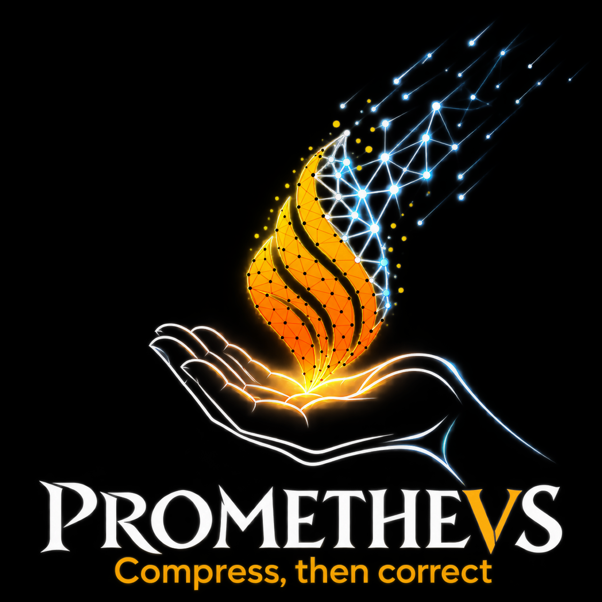
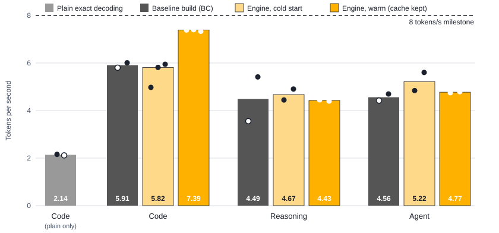
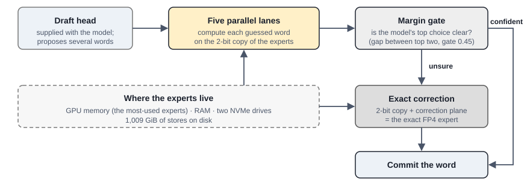

# Compress, then correct: the full DeepSeek-V4.1-Flash-1017 on a five-year-old gaming PC

PROMETHEVS Technical Report 1 · version 0.1 (research preview) · Ryan Flavell, MAGNVS Ltd (ryan@magnvs.co.uk) · October 2026

**Why.** Frontier-level AI today needs either a cloud subscription or hardware costing tens of thousands of pounds. PROMETHEVS, named after Prometheus, who in the myth brought fire to people, sets out to change that: frontier capability, at a speed close to the cloud, within 97 percent of what the original full weights would say, on a computer people already own. This release is the first step.

PROMETHEVS runs the full DeepSeek-V4.1-Flash-1017, a 510 GB mixture-of-experts model, on a five-year-old gaming PC (Ryzen 9 3950X, 64 GB of DDR4, an RTX 3060 with 12 GB, two NVMe drives). The method is compress, then correct. Every word is first computed on a 2-bit copy of the model's experts, which reads about 60 percent of the bytes of the original. The model's own confidence, the margin between its top two candidates, then marks the words it may have got wrong, and only those are recomputed with the original FP4 weights, which a stored correction plane rebuilds from the 2-bit copy. The engine runs at nearly the speed of the 2-bit copy while staying close to the original model.

On a code prompt it generates 5.8 tokens per second from a cold cache and 7.4 once the cache is warm, against 2.14 for plain exact decoding on the same machine; with the corrections switched off, the 2-bit copy ran the same warm pass at 7.7 (one pass, in a separate test build). Reasoning and agent prompts run at 4.4 to 5.2. On 960 audited words, the 2-bit copy alone picks the same word as the original weights 97.40 percent of the time, and the corrected output 98.33 percent. The differences left are near-ties the engine keeps on purpose, where the two candidates are almost equally likely, and words the model was confident about and never checked; counting only those unchecked words, agreement is 99.17 percent (these count the differences an audit at gate 0.9 detected; words with a margin of 0.9 or more were not checked). On the longer 1,101-token agent prompt, agreement counting every difference is 95.91 percent.

## Results

Measured on the build machine, 160 new tokens per prompt, two passes per run. **Cold** is a pass that starts with an empty expert cache. **Warm** is the second pass of the same prompt with the cache kept from the first, which is the best case for a cache; a real session that sends a different prompt lies between the two. Every individual run is in [RESULTS.md](RESULTS.md).

| | Engine (full method) | Baseline build (first frozen build) |
|---|---|---|
| Speed, code prompt, cold | 5.8 tokens/s (runs 4.98, 5.82, 5.95) | 5.9 (runs 5.80, 6.01) |
| Speed, code prompt, warm | 7.4 tokens/s (runs 7.39, 7.40, 7.34) | 6.6 (one run) |
| Speed, reasoning prompt, cold / warm | 4.7 / 4.4 | 4.5 (runs 3.56, 5.41) / 4.1 (one run) |
| Speed, agent prompt, cold / warm | 5.2 / 4.8 | 4.6 (runs 4.42, 4.70) / 4.2 (one run) |
| Plain exact decoding on the same PC, cold, for scale | 2.14 tokens/s (the engine's cold code prompt is about 2.7 times faster) | |
| Agreement with the exact path, 960 words | 99.17 percent (8 slips) | 98.96 percent (10 slips) |
| Agreement, 1,101-token prompt | 97.80 percent | 97.16 percent |
| Agreement, 4,288-token prompt | 100.00 percent | 99.69 percent |
| Agreement counting every difference, 960 words | 98.33 percent | 98.33 percent |
| 2-bit copy alone, before correction, 960 words | 97.40 percent | 96.98 percent |
| GSM8K, 10 problems | 9 correct | 9 correct |

Agreement is measured word by word against the word the exact path would choose given the same history. A slip is a difference the engine did not check, because the model was confident; the unchecked count counts those. Counting every difference also includes the words the engine checked and deliberately kept at a near-tie (both words almost equally likely). On its own the 2-bit copy picks the full-weight word on 97.4 percent of words; with the corrections, 98.33 percent counting every difference (99.17 percent by the unchecked count). The engine differs from the baseline build in two ways: it holds the draft head's experts in the 2-bit format too, and it keeps the expert cache from the first pass into the second. Keeping the cache lifted the code prompt but not the reasoning or agent prompts (the report gives the round timers behind this). In all three warm code passes no correction overturned a word, so the cache, the 2-bit draft head and the absence of an overturn are not separated, and 7.4 is a best case, not a typical session.

## How it works

The engine does four things at once.

**A 2-bit copy answers every word.** The experts are stored in a 2-bit format that is smaller than the original FP4, so each word needs fewer bytes from disk. That is what makes the machine fast enough to be useful.

**The model's own confidence picks the words to redo.** For each word the engine looks at the gap between the model's top two candidates. When the gap falls below a threshold, the gate (0.45 here), the word is flagged.

**Flagged words are corrected exactly.** A stored correction plane turns an expert's 2-bit copy back into the exact FP4 expert, so a correction is the full model's answer for that word.

**A draft head proposes several words at a time.** DeepSeek ships a draft head with the model. The engine checks its guesses together in parallel lanes, which spreads the cost of reading experts across several words. The experts the model uses most sit in GPU memory; the rest live in RAM and on the two drives.

We call this compress-then-correct. Speculative decoding, quantised drafts and offloaded mixture-of-experts inference are the work it builds on; the report sets the method beside the closest references.

## Hardware and disk

The build machine is a Windows 11 desktop with 64 GB DDR4, an RTX 3060 12 GB, and two NVMe drives (2 TB and 1 TB). The stores need about **1,009 GiB**: 475 GiB of raw weights plus 534 GiB of derived stores (2-bit copies, correction planes, and FP4 copies of the first layers). Disk is the largest barrier for anyone repeating this. We kept each drive below about 90 percent full.

## What is included

- The technical report (PDF and Markdown) and its figures
- The logs behind every number in it, unedited ([RESULTS.md](RESULTS.md) lists them)
- The commands we ran to build the stores and the measurements ([REPRO.md](REPRO.md))

## What is not included

- The engine program, its source and the build scripts. This release is the method and the measurements; the engine is planned for a later release, together with the PROMETHEVS app.
- A one-command installer. Building the stores took many hours of hand-run scripts that use the build machine's paths.
- A server that runs the corrected route.
- A reproduction on a second machine, and a demo of a real agent session.

## Limits

We measured agreement against our own exact path; we have not yet run DeepSeek's reference implementation side by side. Speeds vary by prompt and by run, so we give every run. No prompt reaches the 8 tokens/s milestone we set, and the reasoning and agent prompts run below 5.3. First-word time on long prompts is read-bound: on a 1,163-token prompt the first word arrives after about 126 s (98 s with a candidate prompt-reading setting whose effect on quality we have not fully measured). The 99.17 percent figure covers three prompts of 30, 76 and 1,163 tokens. On a further 1,101-token agent prompt the engine scores 97.80 percent and the baseline build 97.16 (9 slips in 317 words), 0.16 points above our 97 percent contract at the gate we use (at gate 0.30 it falls to 96.21 percent); on a 4,288-token prompt the engine scores 100 percent and the baseline build 99.69. Counting every difference, both builds fall below 97 percent on the 1,101-token prompt (95.91 and 95.58 percent). Each long-prompt audit is one run. The chat template matches DeepSeek's encoder on six plain conversations; tool results and thinking mode are unchecked. All numbers come from one machine, one model and one prompt family.

## Reproduce

[REPRO.md](REPRO.md) outlines the steps we ran: download and verify the weights, build the stores, set the profile, run the benchmark. The scripts themselves are not part of this release.

## Licence

The contents of this repository are MIT, copyright Ryan Flavell, MAGNVS Ltd. DeepSeek-V4.1-Flash-1017 is MIT, copyright DeepSeek. Credits for third-party work are in [THIRD_PARTY_NOTICES.md](THIRD_PARTY_NOTICES.md).

## Acknowledgements

We build on DeepSeek's model and draft head and on the ggml and llama.cpp libraries. Ryan Flavell conceived the method and the ideas it tests, set the direction and the quality bar, decided what was built and tested, and checked the results. The engine code, the test runs and the drafts of this report were built together with AI coding assistants working under his direction.

---

 PROMETHEVS is developed by MAGNVS Ltd.
